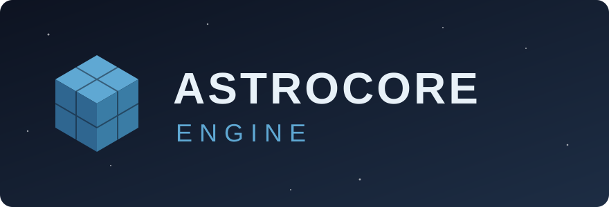

<div class="header" align="center">

</div>

Astrocore Engine — универсальный игровой движок на Rust поверх [Bevy](https://bevyengine.org) для
многопользовательских 3D-песочниц: физически трёхмерный мир на структурной сетке со свободной
геометрией, воксельные модели, сервер-авторитарное состояние с предсказанием на клиенте и
редактор карт Astrocore Studio.

Это репозиторий движка. Игр, контента, карт и правил здесь нет: они живут в отдельных
репозиториях и подключают движок как зависимость. Основная игра на движке —
[Astrocore Build](https://github.com/Astrocore-Studio/Astrocore-Build).

Если вы хотите делать свою игру на Astrocore или развивать сам движок — вам нужен этот
репозиторий. Если вы хотите играть, поднять сервер или делать контент — вам нужен Build.

## Ссылки

<div class="header" align="center">

[Astrocore Build](https://github.com/Astrocore-Studio/Astrocore-Build) | [Задачи (issues)](https://github.com/Astrocore-Studio/Astrocore-Engine/issues) | [Обзор и крейты](docs/OVERVIEW.md) | [Состояние](docs/PROGRESS.md) | [Решения (ADR)](docs/ADR)

</div>

## Документация

- [docs/OVERVIEW.md](docs/OVERVIEW.md) — крейты, быстрый старт, примеры запуска.
- [docs/PROGRESS.md](docs/PROGRESS.md) — что сделано и известные ограничения.
- [docs/ARCHITECTURE.md](docs/ARCHITECTURE.md) — устройство движка, зависимости крейтов, жизненный цикл.
- [docs/WORLD_FORMAT.md](docs/WORLD_FORMAT.md) — мир, координаты, ревизии, идентификаторы.
- [docs/NETWORKING.md](docs/NETWORKING.md) — протокол и репликация.
- [docs/RENDERING.md](docs/RENDERING.md), [docs/EDITOR.md](docs/EDITOR.md), [docs/ASSETS.md](docs/ASSETS.md), [docs/PERSISTENCE.md](docs/PERSISTENCE.md).
- [docs/TEST_PLAN.md](docs/TEST_PLAN.md), [docs/BENCHMARKS.md](docs/BENCHMARKS.md) — тесты, приёмка, измерения.
- [docs/ADR](docs/ADR) — архитектурные решения.

Координаты: метры, ось Y вверх, 1 тайл = 1 м.

## Участие

Помощь принимается от всех. Берите задачи из
[issues](https://github.com/Astrocore-Studio/Astrocore-Engine/issues) и не бойтесь спрашивать.
Движок не знает об игровых механиках: всё игровое — в Build и других играх, в движке — только
общие возможности (мир, физика, сеть, рендер, редактор).

Перед отправкой изменений всё должно проходить без ошибок и предупреждений:

```bash
cargo fmt --all -- --check
```

```bash
cargo clippy --workspace --all-targets -- -D warnings
```

```bash
cargo test --workspace
```

Решения, меняющие архитектуру, оформляются ADR в `docs/ADR`. После изменения движка игры
подтягивают новую версию командой `cargo update -p <крейт>`.

## Сборка

1. Установите Rust stable (не ниже 1.97.1) через [rustup](https://rustup.rs).
2. Склонируйте репозиторий:
```bash
git clone https://github.com/Astrocore-Studio/Astrocore-Engine.git
```
3. Соберите и проверьте движок:
```bash
cd Astrocore-Engine
```
```bash
cargo test --workspace
```
4. Демо-сцена клиента и редактор карт:
```bash
cargo run -p astrocore-client -- --demo
```
```bash
cargo run -p astrocore-studio
```

Сервер, сетевые режимы и инструменты — в [docs/OVERVIEW.md](docs/OVERVIEW.md#быстрый-старт).

## Лицензия

Astrocore Engine распространяется по лицензии
[GNU Affero General Public License v3.0 или новее](LICENSE) (`AGPL-3.0-or-later`).

Если вы распространяете движок или игру на нём либо запускаете изменённый движок как сетевой
сервис, AGPL обязывает предоставить исходный код пользователям, включая ваши изменения.

Ассеты, которые использует движок в демо и тестах, распространяются по лицензиям, указанным в их
файлах метаданных; подробности — в [docs/ASSETS.md](docs/ASSETS.md).
