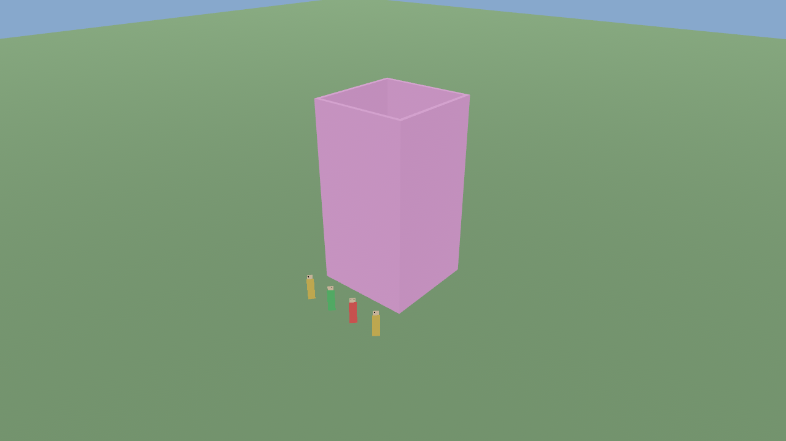

# Astrocore Engine

Универсальный игровой движок на Rust (поверх [Bevy](https://bevyengine.org)) для
многопользовательских 2.5D/3D-песочниц: физически трёхмерный мир, структурная сетка
и свободная геометрия, 2D-спрайты (directional billboards) в 3D-сцене,
сервер-авторитарное состояние, графический редактор карт (Astrocore Studio).

> **Репозиторий содержит только движок.** Игровые билды, контент, карты, правила и
> сеттинги живут в отдельных репозиториях и подключают движок как зависимость.

Проектный документ: страница «Astrocore Engine — Архитектура гибридного 3D-мира и
редактора карт» в Notion (версия 1.2). Принятые решения зафиксированы в
[`docs/ADR`](docs/ADR), фактическое состояние — в [`docs/PROGRESS.md`](docs/PROGRESS.md).

## Что уже есть

Рабочая основа движка, проверенная тестами; клиент с рендером проверен скриншотами на
программном Vulkan:

| Крейт | Назначение |
| --- | --- |
| `astrocore-math` | Конвенция координат (метры, **Y-up**, правосторонняя), чанки, ячейки, рёбра, преобразования сетки |
| `astrocore-core` | Идентификаторы, ревизии, версии схем |
| `astrocore-world` | Канонический мир: стены, проёмы, перекрытия, лестницы, пандусы, свободные модели; команды, ревизии, dirty-регионы |
| `astrocore-geometry` | Меши и коллизионные коробки, сварка углов, импорт GLB |
| `astrocore-spatial` | Топология: комнаты, порталы с независимыми каналами, диагностика |
| `astrocore-navigation` | Пути по этажам и лестницам, кэш тайлов с инкрементальным обновлением |
| `astrocore-physics` | Коллизия мира, запросы луча, триггеры, контроллер персонажа (ступени, двери, рельеф) |
| `astrocore-terrain` | Карта высот, кисти, фундаменты, дороги, вода, меши |
| `astrocore-sprites` | Выбор направления спрайта по камере; чтение метаданных RSI |
| `astrocore-prefabs` | Префабы: вложенность, наследование, переопределения, обновление экземпляров |
| `astrocore-assets` | Манифест ассетов: хеши, лицензии, безопасные пути |
| `astrocore-world-compiler` | Клиентский и серверный пакеты, инкрементальная детерминированная сборка |
| `astrocore-runtime` | Двери, стриминг чанков, уровни активности, API игровых модулей, инфраструктура симуляций |
| `astrocore-persistence` | Снимок + журнал, восстановление, миграции |
| `astrocore-protocol` | Версионированный бинарный протокол |
| `astrocore-network` | Авторитарный сервер, клиент с предсказанием, интерес, TCP |
| `astrocore-editor` | Ядро Studio: undo/redo, инструменты, валидатор, проекты, «играть отсюда» |
| `astrocore-bevy` | Bevy-плагины серверной симуляции (без графики) |
| `astrocore-studio` | Окно редактора карт (Bevy + egui) |
| `astrocore-render` | Клиентский рендер: меши чанков, направленные спрайты, камеры |
| `astrocore-server` | Headless-сервер (пакетный режим и сетевой `--listen`) |
| `astrocore-client` | Клиент: `--demo`, `--connect` (TCP), `--connect-udp` (шифрованный UDP), `--assets`, `--screenshot` |
| `astrocore-tools` | Валидатор карты, компилятор пакетов, демо-проект, бенчмарки |
| `astrocore-vertical-slice` | Приёмочные сценарии AC-VS1 |

**Ещё нет:** гизмо и браузера ресурсов в Studio, подключения Avian/Lightyear. Подробности — в [`docs/PROGRESS.md`](docs/PROGRESS.md).



## Быстрый старт

Нужен Rust stable (проверено на 1.99.1; Bevy 0.20 требует не ниже 1.97.1).

```bash
cargo test --workspace
```

```bash
./scripts/check-headless.sh
```

```bash
cargo run -p astrocore-vertical-slice
```

```bash
cargo run -p astrocore-server -- --data-dir ./data --listen 127.0.0.1:7777 --allow-edit
```

```bash
cargo run -p astrocore-client -- --connect 127.0.0.1:7777 --world-id world
```

Шифрованный UDP: сервер печатает свой открытый ключ, клиент закрепляет его.

```bash
cargo run -p astrocore-server -- --data-dir ./data --listen-udp 127.0.0.1:7778 --key-file ./server.key --allow-edit
```

```bash
cargo run -p astrocore-client -- --connect-udp 127.0.0.1:7778 --server-key <64 hex-символа> --assets ./models
```

```bash
cargo run -p astrocore-client -- --demo
```

```bash
cargo run -p astrocore-studio
```

```bash
cargo run --release -p astrocore-tools -- bench
```

Перед отправкой изменений (правило 4 раздела 26 дизайн-документа):

```bash
cargo fmt --all -- --check && cargo clippy --workspace --all-targets -- -D warnings && cargo test --workspace
```

## Документация

- [`docs/ARCHITECTURE.md`](docs/ARCHITECTURE.md) — крейты, зависимости, жизненный цикл
- [`docs/WORLD_FORMAT.md`](docs/WORLD_FORMAT.md) — мир, координаты, ревизии, идентификаторы
- [`docs/PERSISTENCE.md`](docs/PERSISTENCE.md) — снимки, журнал, миграции
- [`docs/NETWORKING.md`](docs/NETWORKING.md) — протокол и репликация
- [`docs/RENDERING.md`](docs/RENDERING.md) — режимы отображения, спрайты (проект)
- [`docs/EDITOR.md`](docs/EDITOR.md) — Astrocore Studio (проект)
- [`docs/ASSETS.md`](docs/ASSETS.md) — ассеты, RSI, лицензии
- [`docs/TEST_PLAN.md`](docs/TEST_PLAN.md) — тесты и приёмка
- [`docs/BENCHMARKS.md`](docs/BENCHMARKS.md) — измерения
- [`docs/ADR`](docs/ADR) — архитектурные решения

## Лицензия

Проприетарная, все права защищены — см. [`LICENSE`](LICENSE).
