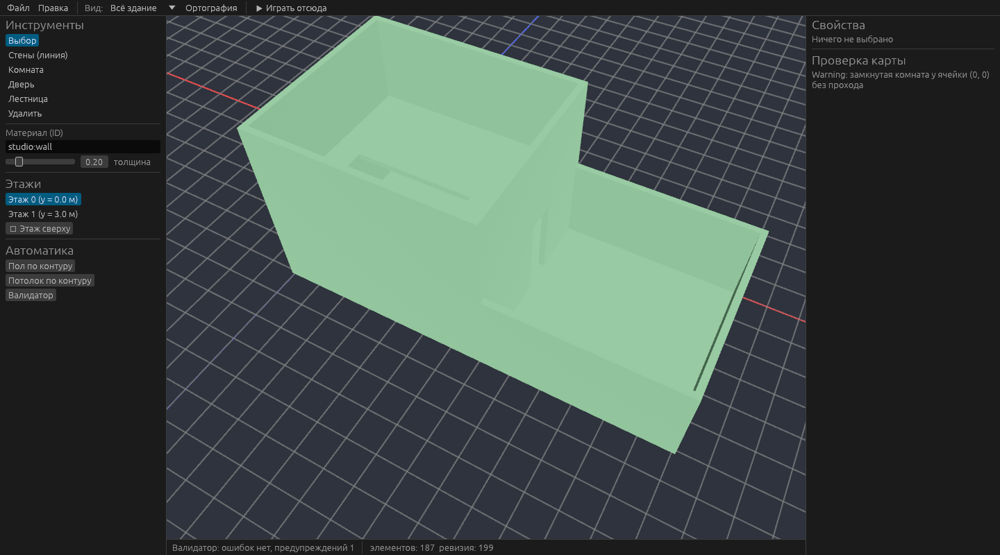

# Astrocore Studio

Реализовано **ядро** (`astrocore-editor`) без графической оболочки: всё ниже покрыто тестами.

## Есть

* **Сессия правок** с undo/redo: транзакции «всё или ничего», откат при ошибке, ограниченная
  глубина, обнаружение внешних изменений мира; обратные команды вычисляются до применения.
* **Инструменты:** линия стен (идемпотентна, не заменяет проёмы), комната с полом и потолком,
  **автоматические пол/потолок по замкнутому контуру** (по топологии), **лестница с пробивкой
  перекрытий**, копирование/поворот/зеркало области (в том числе свободных моделей), перемещение
  с сохранением `ObjectId`, массовая замена материала, выбор прямоугольником, этаж «над».
  Сварка углов и Т-стыков стен — в геометрии (меши и коллизия).
* **Префабы:** размещение и обновление экземпляров, отчёт о конфликтах.
* **Привязка:** к сетке, вершинам, рёбрам, поверхностям; выбор по лучу.
* **Валидатор:** замкнутые комнаты, лишние проёмы, лестницы без площадки, оставленные над
  лестницей перекрытия, пустые этажи (с серьёзностью).
* **Режимы просмотра этажей:** все / срез (скрывает верхние этажи и потолок среза) / рентген.
* **Проекты:** сохранение/загрузка с проверкой (версия, мир, префабы, ссылки).
* **«Играть отсюда»:** настоящий `GameServer` на копии карты, в том числе с TCP-слушателем.
* **Инструменты командной строки:** `astrocore-tools validate | compile | verify | demo-project`.

## Окно Studio (`apps/astrocore-studio`)

Оболочка на Bevy + egui (`bevy_egui 0.43.1`, ADR-0008) над `StudioState` — логикой, которая
тестируется без окна (10 тестов: инструменты, привязка, выбор, удаление, этажи, виды, проекты).
Окно: меню «Файл/Правка», режим вида (всё/срез/рентген), перспектива/ортография, «Играть отсюда»;
панели инструментов, этажей, автоматики, свойств выбранного и проверки карты; сетка и оси
текущего этажа, «призрак» операции, рамки выделения; мышь: ЛКМ — инструмент, ПКМ/СКМ — камера,
колесо — масштаб; Ctrl+Z / Ctrl+Y.

Проверено скриншотом на программном Vulkan (`astrocore-studio --demo-room --screenshot ...`);
вручную с мышью и клавиатурой окно не проверялось (в среде нет экрана и ввода).

## Нет

Браузер ресурсов, drag&drop, гизмо перемещения, инспектор с редактированием полей (кроме
замены материала), терраин-кисти в интерфейсе (API есть), мультипользовательское
редактирование, визуальные сценарии, плагины редактора (`EditorExtension`), отмена в окне
после «Играть отсюда» не затрагивается (копия карты).
