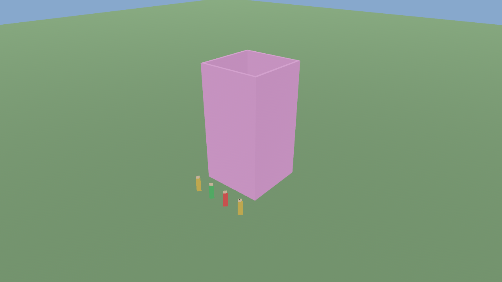
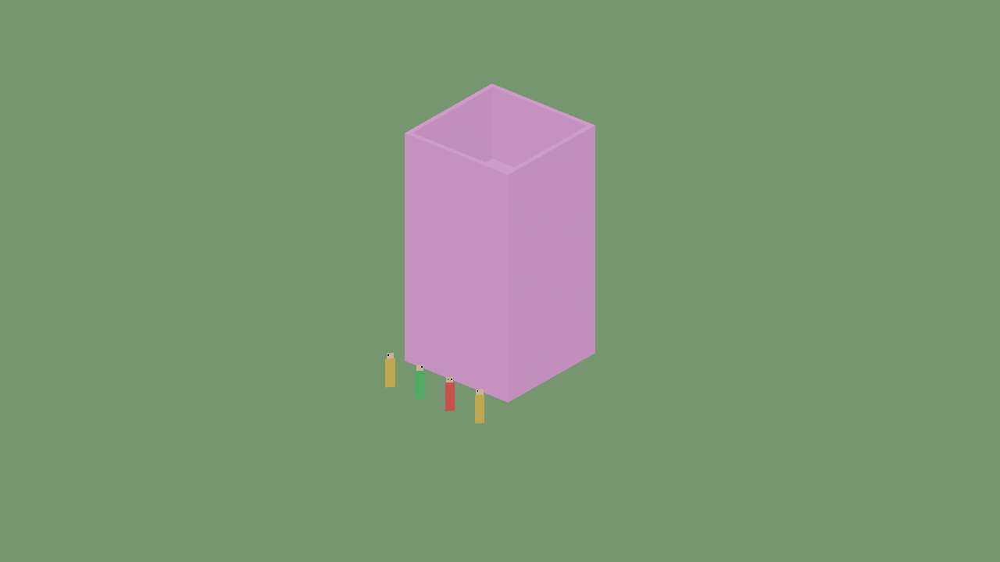

# Рендеринг

Реализация: `astrocore-render` (библиотека) и `astrocore-client` (приложение) на Bevy 0.20.

## Что есть

* **Меши чанков:** `WorldMeshPlugin` пересобирает только затронутые регионы (чанк × этаж) по
  dirty-спискам; батчинг по материалам; свободные модели — GLB из папки `--assets` (`ModelLibrary`, кэш, ошибка загрузки
  сообщается один раз) или габаритный ящик, если файла нет.
* **Свет и тени:** `LightSource` (точечный или прожектор) превращается в свет Bevy;
  `ShadowSettings` включает тени солнца и локальных источников с лимитом теневых источников;
  `EmissiveMaterials` задаёт излучающие материалы по идентификатору прототипа.
* **Слои спрайтов:** `spawn_sprite_layer` добавляет слой (экипировка) с тем же направлением кадра;
  порядок — смещением к камере.
* **Диагностика:** `RenderStats` (объекты, треугольники, оценка вызовов, память мешей, время кадра);
  GPU-таймеров и overdraw пока нет (нужен GPU).
* **Дальность отрисовки:** `DrawDistance` скрывает регионы дальше порога от камеры.
* **Рельеф:** `TerrainPlugin` строит меш по чанкам из `RenderedTerrain` (клиент заполняет его из
  реплики), вода — плоскость на уровне воды.
* **Направленные спрайты:** вертикальный квадрат, повёрнутый к камере вокруг Y; кадр выбирается
  по повороту объекта относительно камеры (4/8 направлений, порядок RSI); nearest-фильтрация,
  `AlphaMode::Mask`. Демонстрационный лист генерируется кодом — настоящие спрайты приходят из билда.
* **Камеры:** перспективная (основная) и ортографическая (`O`), орбита и первое/третье лицо.
* **Клиент:** `--demo`, `--connect host:port`, `--screenshot файл.png`.

Проверено скриншотами на программном Vulkan (lavapipe) под Xvfb — `scripts/render-smoke.sh`,
в CI отдельная задача:

(цвет зданий — заглушка по хешу идентификатора материала; четыре спрайта обращены в разные
стороны, поэтому показывают разные кадры — красный, синий, зелёный, жёлтый.)

## Режимы отображения (`Appearance.render_mode`)

| Режим | Назначение | Статус |
| --- | --- | --- |
| `directional_billboard` | персонажи, мобы, мелкие предметы | **реализовано** |
| `wall_box` | бокс по сетке (стены) | геометрия есть, текстуры из атласа — нет |
| `floor` | плоскость на полу | геометрия плит есть, материалы — нет |
| `prop_model` / `static_mesh` | модель вместо спрайта | импорт и загрузка в клиенте есть |
| `billboard`, `procedural_mesh`, `skinned_mesh` | | проект |

## Чего нет

Качество теней по бенчмаркам, LOD-меши, occlusion culling, инстансинг, texture arrays/атласы,
текстуры рельефа, диагностика рендера
(draw calls, overdraw), измерения на GPU.
